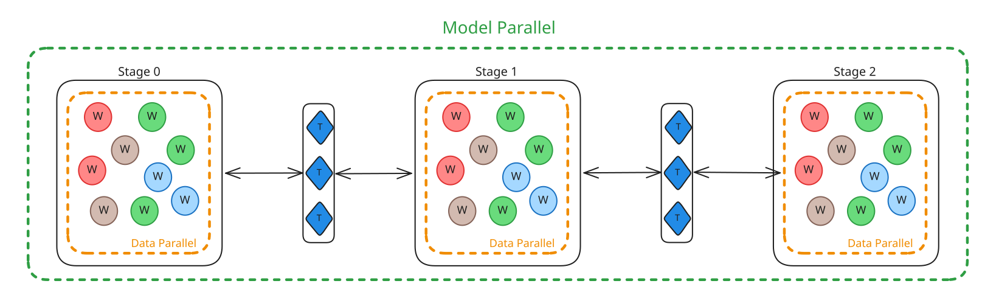

# Node0

Collaborative, decentralized pretraining on commodity hardware —
a 24 GB consumer GPU is enough to join a live training run.

[!card compact](quick_start/index.md)
[!card compact](protocol/overview.md)

---

## What is Node0?

Node0 is the client that connects a consumer GPU to a collaborative training run. Each participant holds a small portion of the model's computation graph, and allows participants to join and leave at any time; the system scales horizontally as more nodes join.

- **Consumer-grade hardware** — 24 GB GPU, 32 GB RAM, 80 GB disk, 200 Mbps network
- **Cross-platform** — Linux and Windows + WSL2 (CUDA)
- **One-command launch** — `python3 node0_cli.py`
- **Multi-GPU support** — run one node per GPU on the same machine
- **Live swarm participation** — join an ongoing run, warm up, then contribute gradients

---

## Supporting Research and Work

!!!info Protocol Models: Scaling Decentralized Training with Communication-Efficient Model Parallelism: <https://arxiv.org/pdf/2506.01260>
!!!

!!!info ASYNCMESH: FULLY ASYNCHRONOUS OPTIMIZATION FOR DATA AND PIPELINE PARALLELISM: <https://arxiv.org/pdf/2601.22442>
!!!

!!!info Pluralis' Multi-party Training Stack: <https://pluralis.ai/blog/pluralis-multi-party-training-stack/>
!!!

!!!info SWARM Parallelism: Training Large Models Can Be Surprisingly Communication-Efficient: <https://arxiv.org/pdf/2301.11913>
!!!

---

## Documentation

### Quick Start
- [Getting Started with Node0](quick_start/index.md) — requirements, CLI, Docker, first run
- [Cloud providers setups](quick_start/setup_guides/cloud.md) — AWS / GCP / RunPod / Tensordock / Lambda
- [Network setupa](quick_start/setup_guides/network.md) — firewall and WSL2 port-proxy setup
- [Useful links](quick_start/setup_guides/useful_links.md) — SSH, Docker, conda, NVIDIA, git

### Protocol
- [Overview](protocol/overview.md) — System roles and components
- [Worker](protocol/worker.md) — Replica in a stage that performs Forward/Backward and Averaging operations
- [Trainer](protocol/trainer.md) — Dataloader, and orchestrating batches between workers
- [Communication Efficient Training](protocol/communication_efficient_training.md) — Subspace Network compression for low-bandwidth training
