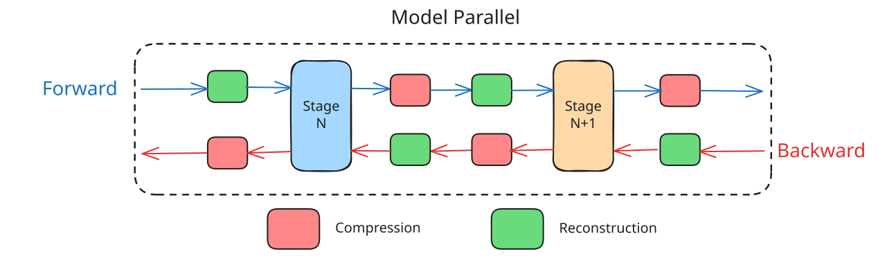

# Communication Efficient Training

The compression layer adapts model architectures and training algorithms to operate under low bandwidth. We compress along two axes: pipeline parallel and data parallel. We introduce each of these below.

## Subspace Networks

Paper: [Protocol Models: Scaling Decentralized Training with Communication-Efficient Model Parallelism](https://openreview.net/pdf?id=kke9TwtKi0)

Pipeline parallelism requires high inter-layer communication. In low-bandwidth settings, this renders training infeasible without activation and activation-gradient compression.

To address this constraint, we use a class of model architecture known as Subspace Networks (SSN), designed specifically for communication-efficient distributed training. SSNs losslessly compress activations and activation gradients between otherwise unaltered transformer blocks in model-parallel stages, achieving up to a 100x increase in communication efficiency.

SSN networks leverage the rank-collapse observed in the projection matrices of large pretrained models and constrain them to a shared and learned low-rank subspace. This reparameterization of the matrices makes the compression lossless. The architecture also handles the high-rank structure from token and positional embeddings, and exploits the recursive structure of transformers.

At stage boundaries, activations are reconstructed and compressed for the forward pass, and activation gradients are reconstructed and compressed for the backward pass. As an example, a 7.5B model with a 4K embedding dimension, 32 layers, FP32 activations, and a 4K sequence length would send a 566Mbit activation for a batch size of 1. With Subspace Networks, this can be compressed to roughly 5Mbits, reducing communication time by about 100x on internet-grade links.

## Asynchronous Sparse Parameter Averaging

Paper: [AsyncMesh: Fully Asynchronous Optimization for Data and Pipeline Parallelism](https://arxiv.org/pdf/2601.22442)

Data parallelism requires cross-worker communication in the DP axis to keep stage replicas in agreement. In a low-bandwidth setting, synchronizing the full parameter state at every step would make workers wait on the network and reintroduce communication as the bottleneck.

To address this constraint, we use asynchronous sparse parameter averaging. Workers continue processing batches and taking local optimizer steps and once every N defined local steps a small subset of parameters is averaged between peers in the same stage. This removes the synchronization barrier from the training loop, while still allowing replicas to gradually converge to a shared state.

In each averaging round, which is done every N steps (20 in the training run), only a sparse fraction of parameters is communicated (this was set to 5% for the training run). The selected subset rotates over time, so all parameters eventually get synchronized without requiring a full-model transfer in any single round.

This makes data-parallel communication proportional to the sparse subset size, and allows the cost of averaging to be hidden behind ongoing local computation. In practice, this is what lets workers in the same stage keep training over internet-grade links without blocking on full synchronous all-reduce rounds.
