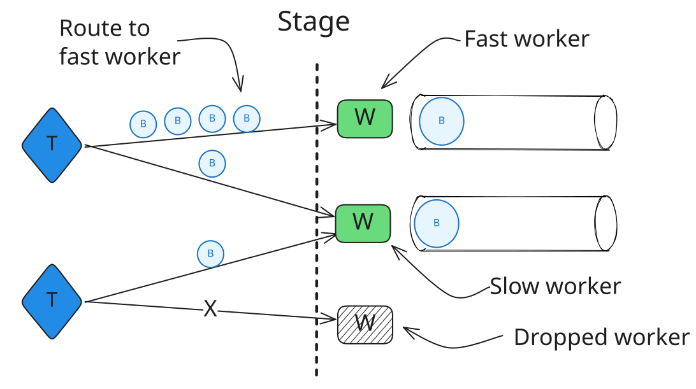
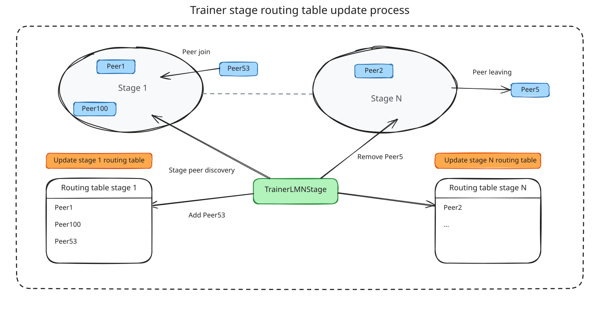

# Trainer

The Trainer is analogous to a standard neural network training loop, but instead of executing computations locally, it orchestrates remote workers across pipeline stages. It has entire knowledge of the network stages and sends activations and gradients between workers of different stages. The Trainer does not host model parameters and does not perform any actual computations — all compute happens on workers.



## Training Flow

### Startup

1. Loads configuration and tokenizer config
2. Prepares the dataset from Hugging Face
3. Creates DHT connections using seed peers. Each model stage has its own dedicated DHT, enabling partitioning across stages
4. Using the DHT, the Trainer discovers workers in each stage — all stages must show at least one available Worker before training can start

### Training Loop

For each batch, the Trainer calls remote workers in pipeline order:

```
hidden = head.forward(input_ids[:, :-1])
hidden = body1.forward(hidden)
hidden = body2.forward(hidden)
loss = tail.forward(hidden, input_ids[:, 1:])   # shifted labels for LM
loss.backward()                                  # triggers backward on all stages
```

For each stage, when choosing a Worker to route batches to, the Trainer uses a min-heap priority queue keyed by accumulated virtual runtime to route each request to the least-loaded Worker. After a Worker completes a request, its runtime is incremented by the estimated task duration and it re-enters the heap. New workers join at the back of the queue.
The Trainer handles remote Worker failures gracefully. Transient network errors trigger retries with the same or a different Worker, and unreachable workers are temporarily short-banned (removed from selection for 30 seconds by default). If all workers in a stage fail, training halts for that pipeline step until a Worker becomes available.

## Peer Discovery

### DHT-Based Worker Lookup

Each stage's workers register themselves in the DHT under a prefix key (e.g., `head.0.`, `body1.0.`, `tail.0.`). The Trainer queries these prefix keys to discover available workers. Each stage is assigned to its own DHT instance, isolating discovery per stage.

At startup, the Trainer creates multiple DHT connections — one per stage. For each stage, a Trainer will query its dedicated DHT to build the initial set of available workers.

### Refresh Mechanism

The Trainer keeps its view of currently available workers through a refresh mechanism that queries the entire stage prefix from the DHT every 600 seconds. This allows discovery of new workers and updating stage routing when a Worker leaves.


