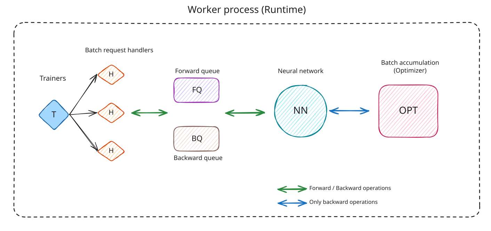
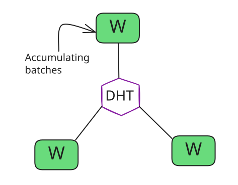
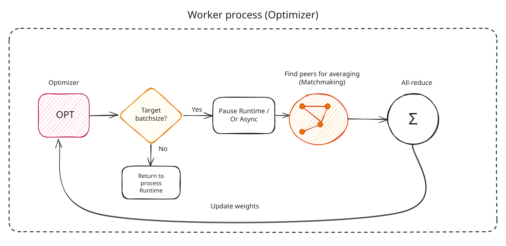

# Worker

A Worker represents a single stage in the pipeline (composed of one or many layers). It hosts the actual model parameters and performs the computations — forward pass, backward pass, update its own weights using a local optimizer and can coordinate and perform all-reduce with peers in the same stage. Workers do not have knowledge of the full network; they only know about their own stage.

## Components

### DHT

The Hivemind Kademlia-based distributed hash table, used unchanged from the [original implementation](https://learning-at-home.readthedocs.io/en/latest/modules/dht.html). Required for peer discovery, expert registration, progress tracking, and matchmaking for all-reduce.

### ModuleBackend

Stores the actual model layers (`nn.Module`) for this stage. Implements forward and backward functions that are invoked by the Runtime. Owns forward and backward processing queues (also called task pools) where incoming requests from trainers are placed before being processed.

### AutoOptimizer

Implements the collaborative optimizer step: accumulates gradients from each backward pass and checks whether the target batch size has been met across all peers in the stage (tracked via DHT). When the target is reached, a submodule performs matchmaking with peers in the same stage and runs all-reduce. The all-reduce is a primitive used to average value across nodes and is used to synchronize model parameters. It can be performed on the accumulated gradients (if using gradient averaging approach) or on the actual layer weights in case of direct weight averaging (state averaging).

The primary optimizer in use is **SPARTA** (`OptimizerAsyncSparta`). In this case only a sparse fraction of parameters (default 5%) are averaged every averaging round via rotating partitions, so all parameters eventually get synchronized. An averaging round can happen once every N local optimizer steps(hence N-step delay).
For more details see: <https://arxiv.org/pdf/2601.22442>

### Connection Handlers

Listens to requests coming from trainers, which place a batch in either the forward or backward processing queue. There can be multiple such listeners which multiplex on the same port.

### DHTHandler

A thread loop in which the Worker constantly declares itself as available in its current stage (e.g., `head.0.0`, `body1.0.1`, `tail.0.0`). This is how trainers discover the Worker and how other Workers in the same stage find each other for matchmaking during all-reduce.

### Runtime

A loop responsible for popping batches out of both forward and backward queues and sending them for execution by invoking the ModuleBackend forward/backward methods. The backward path re-runs the forward pass (activation recomputation — trades compute for memory), then calls `torch.autograd.backward()`, and finally triggers the optimizer step.

## Worker Lifecycle

### Joining a Stage

There are two join paths depending on whether the Worker is the first in its stage:

**Seed Worker** (first Worker in a stage) — Initializes with random weights (or loads from a checkpoint) then starts the Runtime.

**Non-seed Worker** — Must download parameters from an existing peer (or S3 storage) before joining. Discovers peers via DHT, then waits for a safe join window before starting.

### Batch Processing

Once running, the Worker sits in an event loop processing batches from trainers:

1. Trainer sends a forward request via gRPC → Connection Handler places it in the forward queue
2. Runtime pops the batch → calls `ModuleBackend.forward()` → sends the output back
3. Trainer sends a backward request with gradient outputs → Connection Handler places it in the backward queue
4. Runtime pops the batch → calls `ModuleBackend.backward()` → triggers the optimizer step

### Optimizer Step & All-Reduce

Each backward pass accumulates gradients and reports progress to the DHT. When the total samples accumulated across all peers in the stage reach the target batch size:

1. The optimizer performs a local step (gradient clipping and parameter update)
2. Every `N` epochs*, state averaging is triggered — workers in the same stage form a group via DHT matchmaking and run a butterfly all-reduce to synchronize parameters
3. SPARTA sparsification ensures only 5% of parameters are averaged per round, with rotating partitions covering all parameters over time

*the epoch terminology is every time nodes in a stage collectively process number of batches = target batch size, the epoch counter will be incremented for every node in that stage.

### Ghost Mode

Fresh Workers that join a run may have stale weights, if downloading the state took too long. In this case, before contributing gradients to training a Worker goes through two ghost phases:

- **Ghost phase 1** — The Worker does not recieve batches from trainers, syncing weights from peers but does not contribute its own weights.
- **Ghost phase 2** — The Worker is in warm-up mode. It is receiving batches from trainers and processes forward/backward batches, takes local optimizer steps, but does not yet contribute to all-reduce averaging.
- **Off** — Normal operation. The Worker processes batches and fully participates in all-reduce.